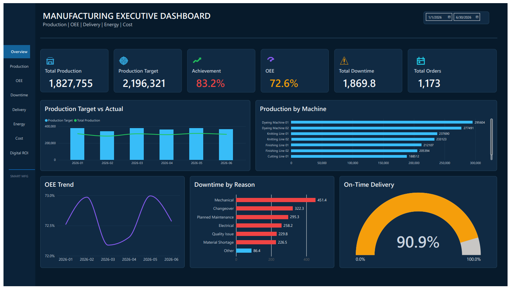
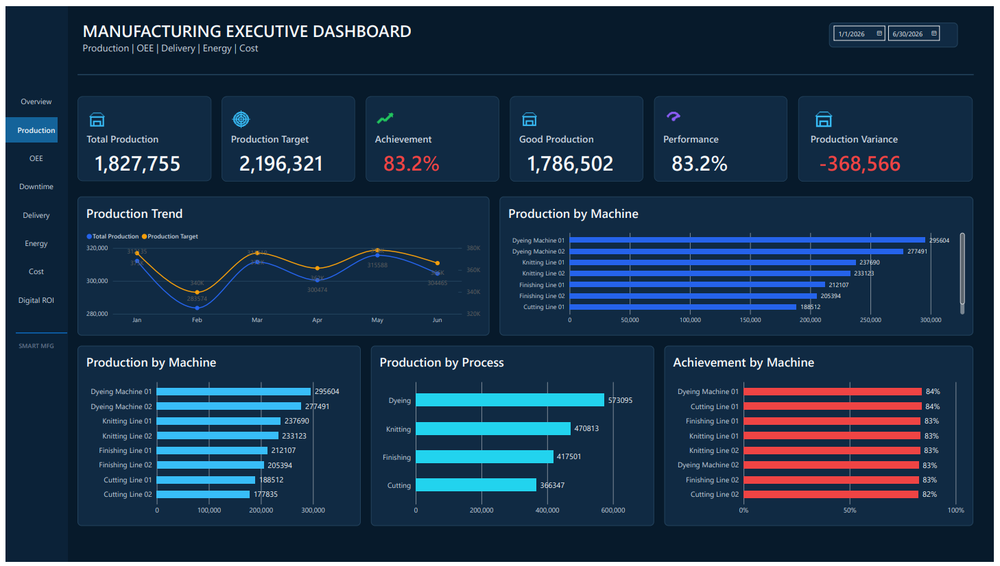
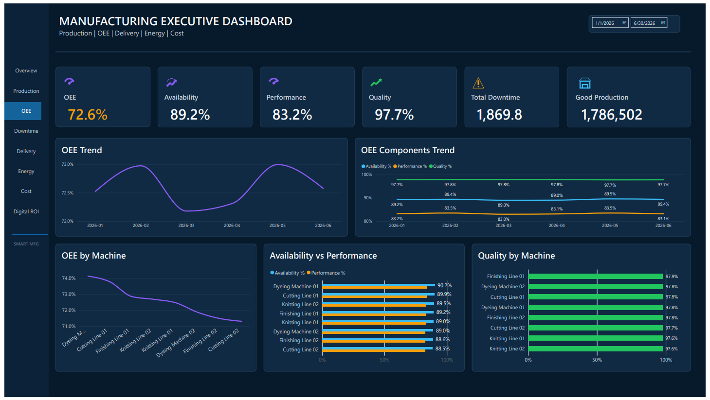
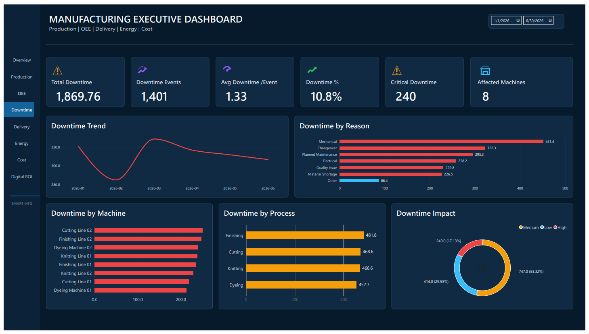
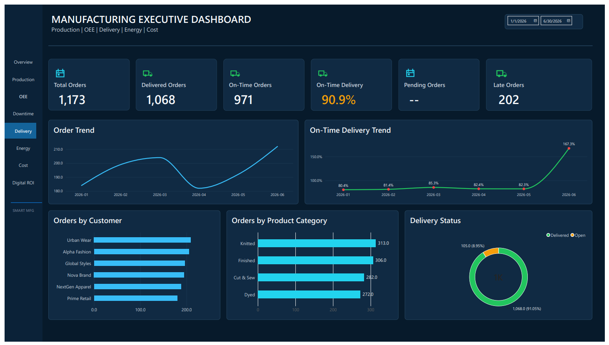
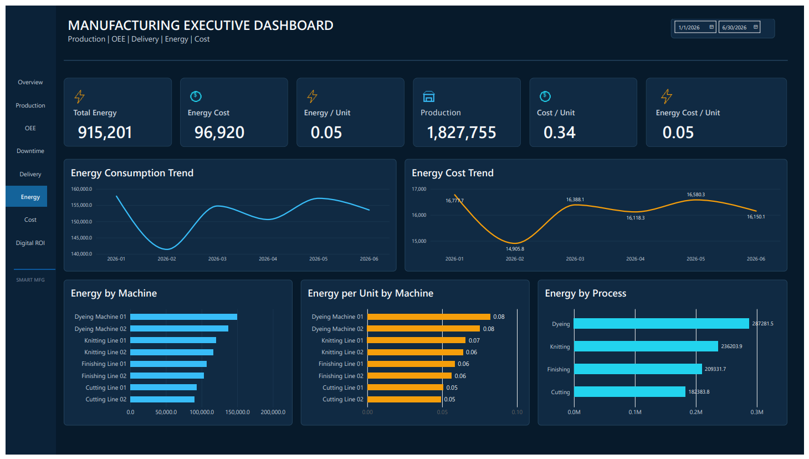
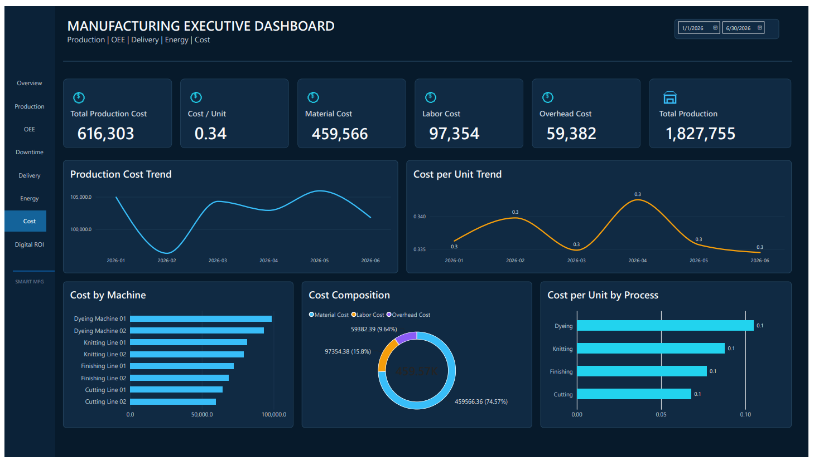
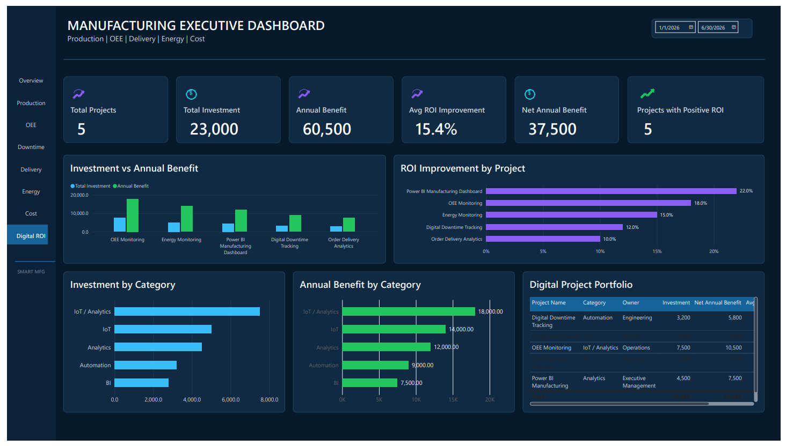

# 🏭 Manufacturing Executive Dashboard

### Transforming Manufacturing Data into Executive Intelligence

An interactive Manufacturing Executive Dashboard built with **Microsoft Power BI**, designed to provide comprehensive visibility into manufacturing operations, production performance, operational efficiency, delivery, energy consumption, and cost analytics.

**[🚀 Open Manufacturing Executive Dashboard](https://app.powerbi.com/view?r=eyJrIjoiZjdjZjYzNjEtZDk4Zi00MjE4LTgzNDktYjUxYjdlODdkYjljIiwidCI6ImJkOGI4MTg0LTNhNjItNDY0NC04ZDFkLWVkZjliYmVkNDgxMCIsImMiOjN9)**
---
---

# 📸 Dashboard Preview

Explore the eight interactive dashboard pages.

## 1. Executive Overview

## 2. Production Analytics

## 3. OEE Monitoring

## 4. Downtime Analysis

## 5. Delivery Performance

## 6. Energy Analytics

## 7. Manufacturing Cost Analysis

## 8. Digital ROI

---

## 📊 Project Overview

The Manufacturing Executive Dashboard provides a consolidated view of manufacturing performance through interactive reports and KPI visualizations.

It helps management monitor operational performance, identify production bottlenecks, analyze downtime, and evaluate manufacturing efficiency.

**Data:** Synthetic / Sample Data  
**Platform:** Microsoft Power BI

## 📑 Dashboard Modules

The project contains eight visible report pages and one hidden report page.

| # | Module | Purpose |
|---|---|---|
| 1 | Overview | Executive-level manufacturing performance |
| 2 | Production | Production target vs actual analysis |
| 3 | OEE | Overall Equipment Effectiveness monitoring |
| 4 | Downtime | Downtime analysis by reason |
| 5 | Delivery | On-time delivery performance |
| 6 | Energy | Energy performance analytics |
| 7 | Cost | Manufacturing cost analysis |
| 8 | Digital ROI | Digital transformation ROI |
| 9 | Management Intelligence | Hidden management report page |

## 🎯 Key Performance Indicators

The Overview dashboard includes:

- Total Production
- Production Target
- Production Achievement
- Overall Equipment Effectiveness (OEE)
- Total Downtime
- Total Orders
- Production by Machine
- Production Target vs Actual
- OEE Trend
- Downtime by Reason
- On-Time Delivery

## 🛠️ Technology Stack

- Microsoft Power BI Desktop
- Power BI Service
- DAX (Data Analysis Expressions)
- Power Query
- Data Modeling
- Interactive Data Visualization

## 📈 Business Benefits

- Improved manufacturing performance visibility.
- Production target and achievement monitoring.
- Identification of equipment efficiency issues.
- Downtime and operational bottleneck analysis.
- Delivery performance monitoring.
- Energy and manufacturing cost analysis.
- Better data-driven management decisions.

## 🖥️ Live Dashboard

Explore the interactive dashboard:

**[Open Manufacturing Executive Dashboard](https://app.powerbi.com/view?r=eyJrIjoiZjdjZjYzNjEtZDk4Zi00MjE4LTgzNDktYjUxYjdlODdkYjljIiwidCI6ImJkOGI4MTg0LTNhNjItNDY0NC04ZDFkLWVkZjliYmVkNDgxMCIsImMiOjN9)**

## 📂 Project Files

| File | Description |
|---|---|
| `MANUFACTURING EXECUTIVE DASHBOARD.pbix` | Complete Power BI project file |

## 👨‍💻 Project Author

**M. A. Nahid Hasan**

BI & Data Analytics | Manufacturing Analytics | Business Intelligence | Digital Transformation

GitHub: [@nahid3152](https://github.com/nahid3152)

---

*This project uses synthetic sample data for demonstration and portfolio purposes.*
